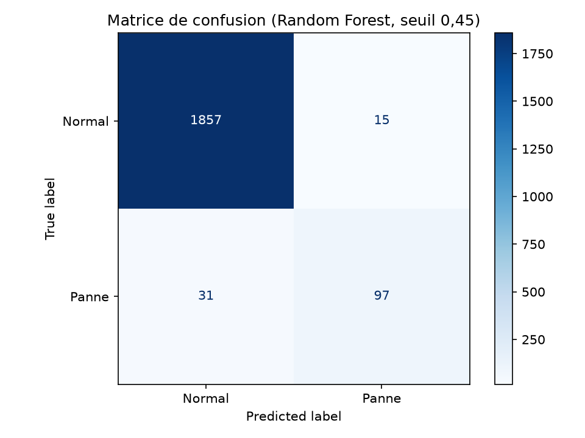

# Maintenance prédictive : détection de pannes de machines par apprentissage automatique

## Contexte et objectif
En milieu industriel, une panne non anticipée provoque des arrêts de production coûteux, tandis qu'une inspection inutile mobilise des ressources sans bénéfice. Ce projet vise à **prédire la défaillance d'une machine à partir de mesures de capteurs**, en recherchant un compromis entre pannes détectées (recall) et fausses alertes (précision).

## Données
- Jeu **AI4I 2020 Predictive Maintenance** (UCI), jeu **synthétique** simulant des cycles d'usinage
- 10 000 observations, dont **6,38 %** de pannes (classes fortement déséquilibrées)
- Variables : type de produit (L/M/H), température de l'air, température du procédé, vitesse de rotation, couple, usure de l'outil
- Cible : `Machine failure` (0 = fonctionnement normal, 1 = panne)

## Méthodologie
1. **Exploration** : qualité des données (aucune valeur manquante), distributions, boxplots, matrice de corrélation
2. **Vérification des règles de panne** : les règles OSF et HDF sont retrouvées dans les données ; la règle documentée pour PWF ne l'est pas dans cette version du jeu
3. **Préparation** : encodage du type de produit, création de trois variables (écart de température, usure × couple, puissance mécanique), retrait des identifiants et des cinq colonnes de modes de panne (TWF, HDF, PWF, OSF, RNF) afin d'éviter une **fuite de données**
4. **Découpage** stratifié 80 % / 20 % (8 000 / 2 000 observations)
5. **Modèles comparés** : régression logistique (référence), Random Forest, XGBoost, avec pondération des classes
6. **Validation croisée à 5 plis** sur le jeu d'entraînement, pour comparer les modèles et choisir le seuil de décision
7. **Évaluation finale unique** sur le jeu de test

## Résultats
Comparaison par validation croisée (moyenne ± écart-type, classe « panne ») :

| Modèle | Précision | Recall | F1 |
|---|---|---|---|
| Régression logistique | 0,23 ± 0,00 | 0,81 ± 0,03 | 0,36 ± 0,00 |
| **Random Forest** | **0,92 ± 0,04** | 0,80 ± 0,04 | **0,86 ± 0,04** |
| XGBoost | 0,79 ± 0,05 | 0,82 ± 0,04 | 0,80 ± 0,03 |

**Modèle retenu : Random Forest (200 arbres), seuil de décision 0,45.** Le seuil a été choisi par validation croisée sur le jeu d'entraînement : il offre un F1 proche du maximum (0,85 contre 0,86) tout en privilégiant le recall (0,81), et en dessous de 0,40 chaque panne supplémentaire détectée coûtait plus de 10 fausses alertes supplémentaires.

Évaluation finale sur le jeu de test (128 pannes) :

| Précision | Recall | F1 | Pannes détectées | Pannes manquées | Fausses alertes |
|---|---|---|---|---|---|
| 0,87 | 0,76 | 0,81 | 97 | 31 | 15 |




Variables les plus importantes : usure × couple, usure de l'outil, écart de température, vitesse de rotation.

## Limites
- Jeu de données synthétique : les performances ne se transposent pas telles quelles à des machines réelles.
- Les pannes manquées sont surtout des pannes d'usure d'outil (TWF) : au seuil de 0,2, 22 des 24 pannes non détectées en relèvent. Dans la zone d'usure critique (200 à 240 min), seuls 8,4 % des outils tombent en panne, ce qui est quasi aléatoire avec les capteurs disponibles.
- Le jeu de test ne contient que 128 pannes : les métriques finales comportent une marge d'erreur de plusieurs points.
- Le choix du seuil dépend du coût réel d'une panne non détectée par rapport à celui d'une inspection inutile.

## Structure du dépôt
```
predictive-machine-ml/
├── ai4i_predictive_maintenance.csv
├── donnees_preparees.csv
├── 01_exploration_preparation_donnees.ipynb
├── 02_modelisation.ipynb
└── README.md
```

## Technologies
Python, pandas, NumPy, scikit-learn, XGBoost, Matplotlib, Seaborn

## Auteur
SOMDA, ENSAM Meknès (génie industriel, spécialisation IA et science des données)